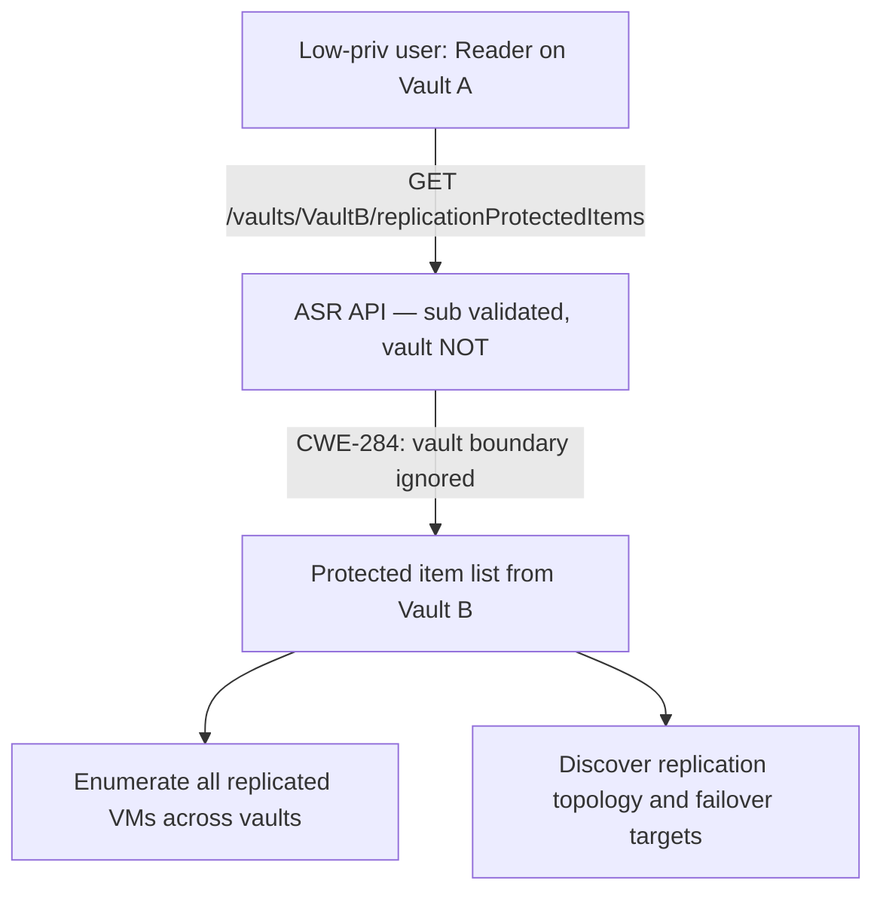

<p align="center"></p>

<p align="center">


</p>

## Overview
**CVE-2026-118286** — CVSS 9.1 CRITICAL improper access control in Azure Site Recovery. A user with Reader access to one recovery vault can enumerate replication-protected items from other vaults in the same subscription due to missing vault-boundary scope validation.

## Attack Flow


## Usage
```bash
python3 poc.py --sub-id "00000000-..." --rg "dr-rg" --victim-vault "prod-vault" --bearer "eyJ..."
```

## References
- [NVD CVE-2026-118286](https://nvd.nist.gov/vuln/detail/CVE-2026-118286)
- [CWE-284](https://cwe.mitre.org/data/definitions/284.html)

<p align="center"></p>
<p align="center"><sub>cveForge — Security Research &amp; Proof of Concept Repository</sub></p>
