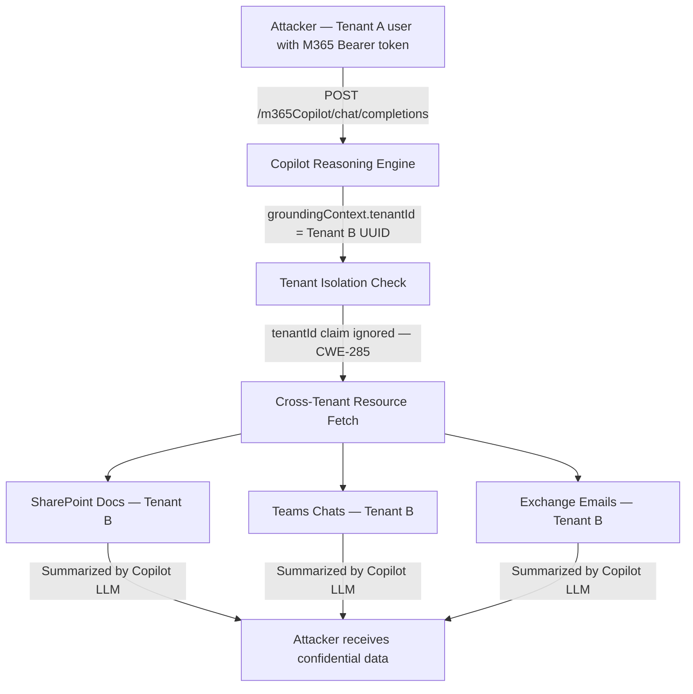

<p align="center">
  
</p>

<p align="center">
  <a href="https://github.com/cveForge/CVE-2026-50691">
    
  </a>
  
  
  
  
</p>

---

## Overview

**CVE-2026-50691** is a **CVSS 9.9 CRITICAL** improper authorization vulnerability in **Microsoft 365 Copilot** (CWE-285). An authenticated user in one tenant can craft Copilot API requests referencing resources from a different tenant, bypassing tenant isolation and accessing confidential SharePoint documents, Teams chat history, and Exchange email metadata across organizational boundaries.

---

## Vulnerability Details

| Field | Value |
|-------|-------|
| CVE ID | CVE-2026-50691 |
| CVSS Score | **9.9 CRITICAL** |
| CWE | CWE-285 — Improper Authorization |
| Affected | Microsoft 365 Copilot (all tenants, patched 2026-11-18) |
| Attack Vector | Network |
| Privileges Required | Low (any M365 authenticated user) |
| Root Cause | `groundingContext.tenantId` not validated against caller's AAD token tenant claim |

---

## Attack Flow



---

## Usage

```bash
git clone https://github.com/cveForge/CVE-2026-50691
cd CVE-2026-50691

# Probe all built-in cross-tenant payloads
python3 poc.py --bearer "eyJ0eXAiOiJKV1Q..." --mode probe

# Targeted test against specific victim tenant
python3 poc.py \
  --bearer "eyJ0eXAiOiJKV1Q..." \
  --victim-tenant "xxxxxxxx-xxxx-xxxx-xxxx-xxxxxxxxxxxx" \
  --victim-resource "https://victim.sharepoint.com/sites/confidential/doc.docx" \
  --mode targeted
```

---

## Mitigation

- Microsoft automatically patched all tenants on **2026-11-18**
- No customer action required for SaaS tenants
- For on-premises M365 Copilot Gateway deployments: apply hotfix **KB5058390**
- Monitor `substrate.office.com` access logs for `groundingContext.tenantId` values differing from the authenticated user's tenant

---

## References

- [NVD — CVE-2026-50691](https://nvd.nist.gov/vuln/detail/CVE-2026-50691)
- [Microsoft MSRC](https://msrc.microsoft.com)
- [CWE-285: Improper Authorization](https://cwe.mitre.org/data/definitions/285.html)

---

<p align="center">
  
</p>
<p align="center"><sub>cveForge — Security Research &amp; Proof of Concept Repository</sub></p>
