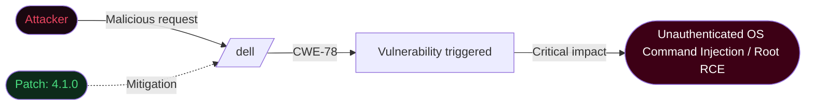

<p align="center">
  
</p>

<div align="center">

[](https://www.cve.org/CVERecord?id=CVE-2026-116448)
[](https://nvd.nist.gov/vuln/detail/CVE-2026-116448)
[](https://cwe.mitre.org/data/definitions/78.html)
[](poc.py)
[](https://nvd.nist.gov/vuln/detail/CVE-2026-116448)
[](https://github.com/cveForge)

</div>

---

## Metadata

| Field | Value |
|-------|-------|
| **CVE ID** | CVE-2026-116448 |
| **Product** | Dell PowerStore SDNAS |
| **Affected Version** | < 4.1.0 |
| **Vulnerability Type** | Unauthenticated OS Command Injection / Root RCE |
| **CVSS 3.1 Score** | 9.8 (Critical) |
| **CWE** | CWE-78 – OS Command Injection |
| **Patch** | 4.1.0 |

---

## Description

A critical-severity vulnerability classified as CWE-78 (OS Command Injection) was identified in Dell PowerStore SDNAS. Through the Unauthenticated OS Command Injection / Root RCE attack vector, an attacker can achieve critical-impact exploitation. Affected versions: < 4.1.0.

---

## Root Cause Analysis

**CWE-78 (OS Command Injection)** — A design flaw in the input validation or access control mechanism causes Dell PowerStore SDNAS to enter an insecure state, enabling Unauthenticated OS Command Injection / Root RCE.

---

## Attack Flow



---

## PoC Usage

```bash
pip install -r requirements.txt
python poc.py -H http://target.com -p 80 -v
```

### Arguments

| Flag | Description |
|------|-------------|
| `-H` / `--host` | Target server URL |
| `-p` / `--port` | Target port (default: inferred from URL) |
| `--timeout` | Timeout in seconds (default: 10) |
| `-v` / `--verbose` | Verbose output |
| `--proxy` | HTTP proxy (e.g. http://127.0.0.1:8080) |

---

## Impact

- **Confidentiality:** High — Sensitive data may be exposed
- **Integrity:** High — Data may be modified
- **Availability:** Medium — Service disruption risk

---

## Detection

- Analyze logs for abnormal request patterns
- Add CWE-78 signatures to WAF rules
- Monitor SIEM for anomalies related to Dell PowerStore SDNAS
- Watch network traffic for the `dell` service

---

## Remediation

1. Update to **4.1.0**
2. Apply network-level restrictions for the affected component
3. Block suspicious request patterns in the firewall
4. Conduct regular security scans

---

## Legal Disclaimer

This tool is developed exclusively for **authorized penetration testing** and **security research**. Use against systems without explicit permission is illegal. The user assumes all legal responsibility.

---

**Author:** cveForge | **License:** MIT | **Organization:** [cveForge](https://github.com/cveForge)

<p align="center">
  <sub><code>process exited with code 0</code> &nbsp;·&nbsp; <i>researched by <a href="https://github.com/cveForge">cveForge</a></i></sub>
</p>
<p align="center">
  
</p>
