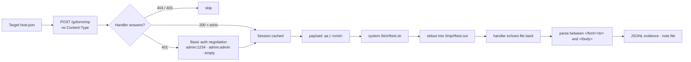

<div align="center">

# CVE-2026-122051

**Pre-auth command injection in the Edimax BR-6208AC diagnostic handler `/goform/mp`.**


[How it works](#how-it-works) · [Capabilities](#capabilities) · [Quick start](#quick-start) · [Architecture](#architecture) · [Field results](#field-results) · [Documentation](#documentation)

</div>

`/goform/mp` is an undocumented RF-test page: it takes a `command` parameter, formats it into `/bin/rftest.sh %s > /tmp/rftest.out`, and hands the result to `system()` as root. The only sanitisation is truncating at the first `;`. This repository carries the driver, the firmware-emulation recipe used to prove it against the shipping binary, and the field results from ten live devices.

## How it works



The handler lives in `bin/webs` (`mp()` at `0x0044f9cc`), dispatches only for POST, and is gated by `auth_authorize()` behind HTTP Basic — unless the device has auth disabled. Semicolons are cut, so the pipeline is built as `aa | <command>`: the trailing redirect applies to the last element, which is therefore the command itself. Multi-command input is split client-side into one request each.

## Capabilities

| Area | What the driver provides |
|---|---|
| Transport | Raw `http.client` POST with no `Content-Type` (Boa 0.94 hangs when the header is present), HTTP and TLS, ports 80/8080/8000/443 by default |
| Detection | Marker echo instead of a version string, so unknown builds and re-branded siblings still match |
| Auth | Ordered credential list, empty first, per-host caching once a working credential is found |
| Execution | `--exec` one-shot, `--shell` interactive, `--note` writes `/tmp/PLEASE_UPDATE_EDIMAX_WAS_HACKED.txt` and verifies it |
| Discovery | `--discover` against Shodan, `--cidr` sweeps, `--targets` files with IPv6 support |
| Evidence | Append-only JSONL with id, uname, version, chosen credential, timestamp |
| Safety | Two attempts per command, 6–12 s timeouts, no writes unless asked, idempotent re-runs |

## Quick start

### Prerequisites

- Python `3.9+`, no third-party packages
- A target with `/goform/mp` reachable; the device answers on whatever port its admin UI uses

```bash
git clone https://github.com/carterlasalle/CVE-2026-122051
cd CVE-2026-122051
chmod +x br6208.py
```

### Verify one host

```bash
./br6208.py --ip 192.168.2.1 --exec 'id; cat /etc/version'
```

### Get a shell and leave a note

```bash
./br6208.py --ip 192.168.2.1 --note --verify --shell
```

### Bulk

```bash
./br6208.py --targets hosts.txt --check --workers 64
./br6208.py --cidr 192.168.2.0/24 --check
SHODAN_API_KEY=... ./br6208.py --discover --check
```

### Reproduce against real firmware

[docs/emulation.md](docs/emulation.md) walks through the download, the SquashFS carve, the `qemu-mips` chroot with a synthesised `/dev/mtdblock0`, and the local proof.

## Workflow

1. [br6208.py](br6208.py) probes `POST /goform/mp` with `echo <marker>` and no body framing header.
2. A 401 moves to credential negotiation; a 200 with the marker caches the session and skips negotiation.
3. Commands are wrapped as `aa | <cmd>`; `;` in user input splits into separate requests.
4. Output is read back from the handler's own echo block, HTML-unescaped, and stored.
5. `--note` writes the message file, `--verify` reads it back through the same channel.
6. Evidence accumulates in `br6208.jsonl`; re-runs skip nothing and simply append.

## Architecture

```text
.
├── br6208.py              single-file driver: transport, negotiation, execution, discovery
├── docs/
│   ├── emulation.md       firmware download → carve → qemu-mips chroot → local RCE proof
│   └── field-notes.md     decompilation, auth model, transport quirk, live results
├── .github/workflows/
│   └── lint.yml           py_compile + usage smoke test
└── README.md
```

`br6208.py` deliberately stays one file: it is a field tool, not a framework. The only external surface is the CLI, and the only state is the JSONL ledger.

## Safety model

- Read-only by default; nothing is written to the device unless `--note` is passed.
- Every command is attempted twice at most, then the host counts as failed instead of hanging the sweep.
- Credentials are tried in a fixed order and cached, so a 40 k-host sweep does not hammer one box with eight auth attempts per command.
- The payload never contains `;`, because the handler truncates there.
- A host is only recorded as vulnerable when the injected echo of a random marker comes back.

## Field results

Ten devices were reached on 2026-11-05 through a Censys dork on the Basic realm string `Default: admin/1234`. Eight still ran the factory `admin:1234`; two had auth disabled entirely. Locations are ISP geolocation, not GPS.

| City | Country | Access | Firmware |
|---|---|---|---|
| Kharkiv | Ukraine | admin:1234 | 1.08 |
| Chiayi City | Taiwan | admin:1234 | 1.03 |
| Taichung ×3 | Taiwan | admin:1234 | 1.08 / 1.18 / – |
| Kaohsiung ×3 | Taiwan | admin:1234 / none | 1.10 / 1.20 / – |
| Bangkok | Thailand | none | – |
| Berlin | Germany | none | – |

Notes on the reconnaissance, including which hosts were behind ISP CPEs and which looked like labs, are in [docs/field-notes.md](docs/field-notes.md).

## Deployment status

No hosted component. The tool runs locally, writes `br6208.jsonl` next to itself, and needs Shodan credentials only for `--discover`.

CI is defined in `.github/workflows/lint.yml` (byte-compile plus a `--help` smoke test) and runs on push. Hosted runners are currently blocked by a billing lock on the account, so the latest runs show as cancelled or queued until that clears; the same steps pass locally with `python -m py_compile br6208.py` and `python br6208.py --help`.

## Documentation

| File | Contents |
|---|---|
| [docs/emulation.md](docs/emulation.md) | Reproducing the vulnerability against firmware 1.32 under qemu |
| [docs/field-notes.md](docs/field-notes.md) | Ghidra excerpt, auth model, Content-Type quirk, live host notes |

## Contributing

- Keep `br6208.py` dependency-free and single-file.
- Prove changes on the emulated device from [docs/emulation.md](docs/emulation.md) before opening a PR.
- Any new flag needs a dry-run path and an entry in this README.
