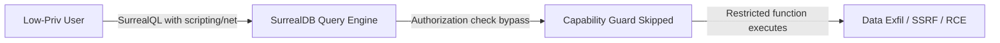

[](https://cve.mitre.org/cgi-bin/cvename.cgi?name=CVE-2026-134292)
[](https://nvd.nist.gov/vuln/detail/CVE-2026-134292)
[](https://cwe.mitre.org/data/definitions/863.html)
[](https://python.org)
[](https://github.com/cveForge)

## Metadata

| Field | Value |
|-------|-------|
| **CVE ID** | CVE-2026-134292 |
| **Product** | SurrealDB |
| **CVSS Score** | 9.8 CRITICAL |
| **CWE** | CWE-863 — Incorrect Authorization |
| **Attack Vector** | Network |
| **Authentication** | Low Privilege |

## Description

SurrealDB's capability restriction system (scripting, networking, guest access) can be bypassed by crafting specific SurrealQL queries that exploit logical flaws in capability authorization checks, allowing restricted operations to be executed.

## Attack Flow



## PoC Usage

```bash
python poc.py http://localhost:8000 root root
```

## Remediation

- Upgrade SurrealDB to the patched version
- Restrict capability flags: `--deny-scripting --deny-net --deny-guests`
- Audit SurrealQL access logs for unauthorized function calls

## Legal Disclaimer

> This PoC is provided for educational and authorized security research only. Unauthorized use is illegal.


