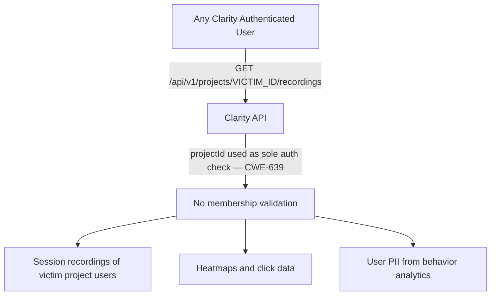

<p align="center"></p>

<p align="center">


</p>

## Overview
**CVE-2026-113824** — CVSS 9.1 CRITICAL authorization bypass via user-controlled key (IDOR) in Microsoft Clarity. The recordings API uses the numeric `projectId` path parameter as the sole access control check. Any Clarity user can enumerate session recordings, heatmaps, and user behavior analytics for any other project by enumerating project IDs.

## Attack Flow


## Usage
```bash
python3 poc.py --bearer "eyJ..." --project-id 123456
# Enumerate a range of project IDs
python3 poc.py --bearer "eyJ..." --project-id 123000 --range 1000
```

## References
- [NVD CVE-2026-113824](https://nvd.nist.gov/vuln/detail/CVE-2026-113824)
- [CWE-639: IDOR](https://cwe.mitre.org/data/definitions/639.html)

<p align="center"></p>
<p align="center"><sub>cveForge — Security Research &amp; Proof of Concept Repository</sub></p>
