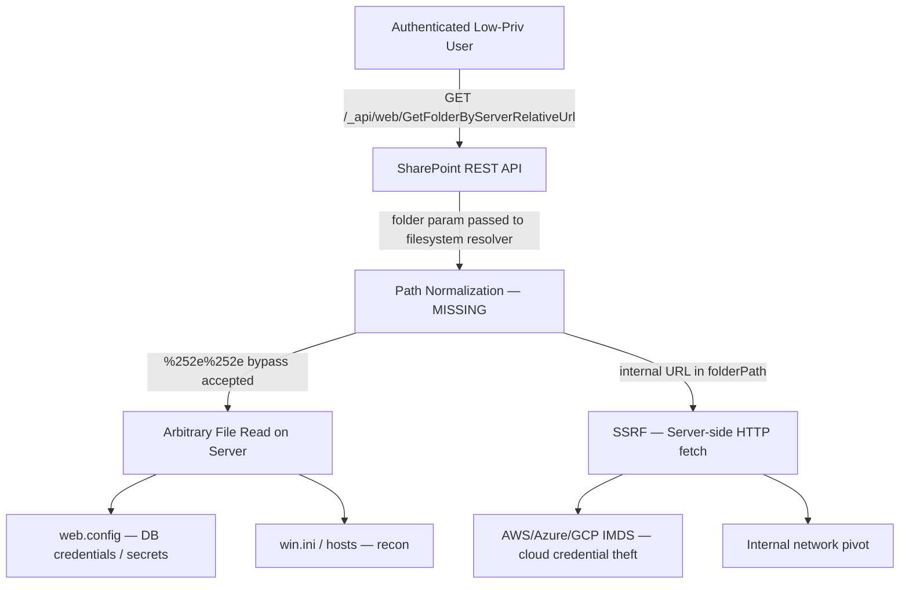

<p align="center">
  
</p>

<p align="center">
  <a href="https://github.com/cveForge/CVE-2026-70193">
    
  </a>
  
  
  
  
</p>

---

## Overview

**CVE-2026-70193** is a **CVSS 9.9 CRITICAL** authenticated path traversal vulnerability in **Microsoft SharePoint** (CWE-22). A low-privileged authenticated user can read arbitrary files on the SharePoint server and trigger SSRF to reach internal network resources, including cloud metadata endpoints.

---

## Vulnerability Details

| Field | Value |
|-------|-------|
| CVE ID | CVE-2026-70193 |
| CVSS Score | **9.9 CRITICAL** |
| CWE | CWE-22 — Improper Limitation of a Pathname to a Restricted Directory |
| Affected | SharePoint Server 2019, SE, Online (on-prem sync agent) |
| Attack Vector | Network |
| Privileges Required | Low (any authenticated user) |
| Root Cause | Double URL-encoded `../` sequences not normalized in REST `folder` parameter |

---

## Attack Flow



---

## Usage

```bash
git clone https://github.com/cveForge/CVE-2026-70193
cd CVE-2026-70193

# Path traversal (read server files)
python3 poc.py --url https://sharepoint.example.com --cookie "FedAuth=TOKEN;rtFA=TOKEN" --mode traversal

# SSRF (reach internal targets from server)
python3 poc.py --url https://sharepoint.example.com --cookie "FedAuth=TOKEN;rtFA=TOKEN" --mode ssrf

# Full chain
python3 poc.py --url https://sharepoint.example.com --bearer "eyJ..." --mode all
```

---

## Mitigation

- Apply **KB5058411** (SharePoint Server 2019) or **KB5058412** (SharePoint SE)
- SharePoint Online was auto-patched by Microsoft on **2026-11-18**
- Restrict `/_layouts/15/GetListItems.aspx` to known IP ranges at WAF
- Enable SharePoint Server audit logging for `/_api/web/GetFolderByServerRelativeUrl` calls

---

## References

- [NVD — CVE-2026-70193](https://nvd.nist.gov/vuln/detail/CVE-2026-70193)
- [Microsoft MSRC Advisory](https://msrc.microsoft.com)
- [CWE-22: Path Traversal](https://cwe.mitre.org/data/definitions/22.html)

---

<p align="center">
  
</p>

<p align="center">
  <sub>cveForge — Security Research &amp; Proof of Concept Repository</sub>
</p>
